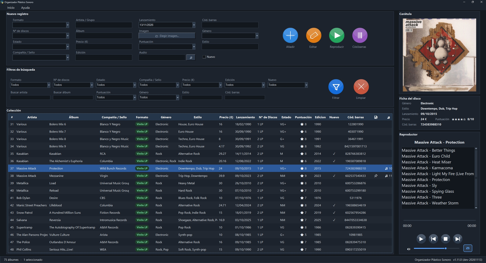
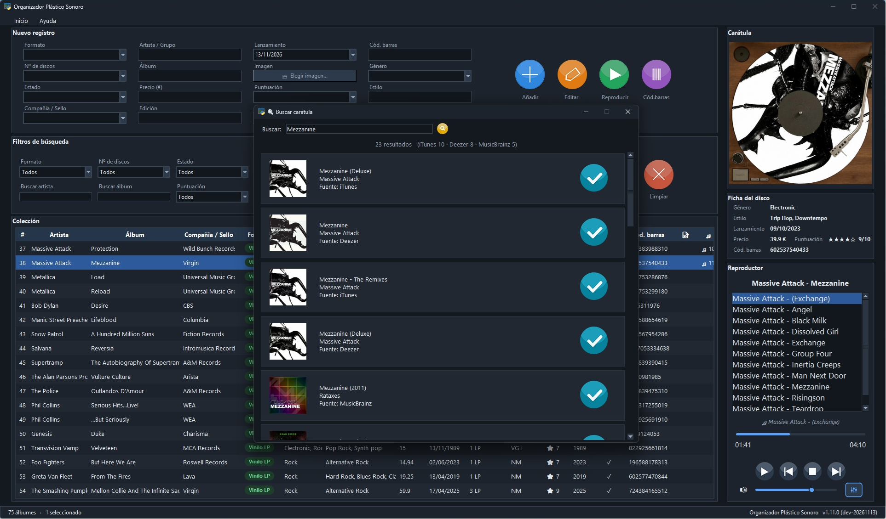
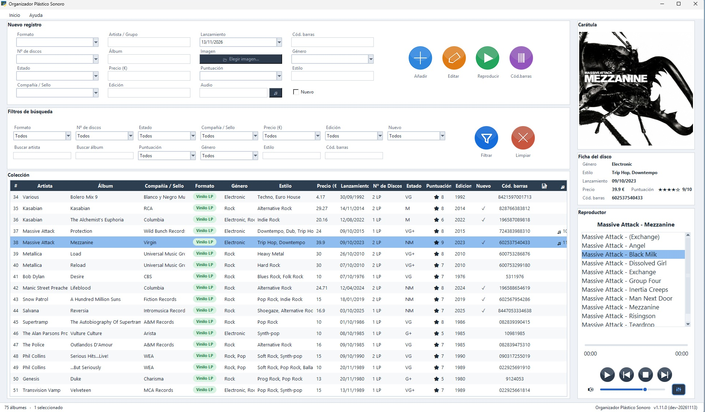

# 🎵 Organizador Plástico Sonoro

**Tu colección de música física, ordenada.** Vinilos, CDs, cassettes, singles, EPs y cajas: con sus carátulas, su valor, sus préstamos y tu lista de deseos.

Gratuito para uso personal · Windows 10/11 · Español, English, Français, Italiano

### [⬇️ Descargar la última versión / Download the latest version](https://github.com/franunez-stack/Plastico-Sonoro/releases/latest)

| Estadísticas | Tema claro |
|---|---|
|  |  |

## ✨ Qué hace

- **Catálogo completo**: artista, álbum, sello, formato, nº de discos, género, estilo, lanzamiento, estado (M, NM, VG+…), puntuación, precio, código de barras, notas, carátula y pistas de audio.
- **Añadir por código de barras** con los datos y la carátula de Discogs.
- **Formatos con color**: LP, maxi 12", 10", EP, single 7", CD, cassette, box set…
- **Préstamos**: a quién, desde cuándo y cuándo tiene que volver, con aviso si se pasa de fecha.
- **Lista de deseos** con prioridad y precio máximo; al escanear en la tienda te avisa si ya lo tienes.
- **Estadísticas**: valor de la colección, gráficos por formato, década, género, artista o sello, y qué discos te falta completar.
- **Exportar a Excel o CSV** (con colores, filtros y hoja de resumen) e **importar** desde Excel, CSV o la colección de Discogs.
- **Reproductor** con ecualizador para escuchar el álbum seleccionado.
- **Tema claro y oscuro**, cuatro idiomas, moneda y formato de fecha a tu gusto.
- **Tus datos a salvo**: guardado seguro y copias de seguridad automáticas.

## 📥 Descarga e instalación

Las descargas están en **[Releases](https://github.com/franunez-stack/Plastico-Sonoro/releases/latest)**:

| Descarga | Para quién |
|---|---|
| `Instalar_Organizador_Plastico_Sonoro_X.Y.Z.exe` | La opción normal: instala el programa con su acceso en el menú Inicio. |
| `Organizador_Plastico_Sonoro_X.Y.Z_portable.zip` | Sin instalar: descomprime y usa (también desde un USB). La colección se guarda junto al programa. |

> **Aviso de Windows («Windows protegió su PC»)**: aparece con los programas nuevos que aún no son conocidos. Pulsa **Más información → Ejecutar de todas formas**.

**Actualizar**: instala la versión nueva encima de la anterior. Tus discos se conservan.
**Dónde están tus datos**: en `Documentos\Organizador Plastico Sonoro` (en la portable, en la carpeta `datos`). Desinstalar no los borra.

## ⚖️ Licencia

Organizador Plástico Sonoro es **gratuito para uso personal y no comercial**. Puedes compartirlo sin modificar y junto a su licencia. No está permitido modificarlo, venderlo ni redistribuirlo de otra forma sin permiso del autor. Consulta `LICENCIA.txt`.

Las librerías de terceros que usa y sus licencias se pueden ver en el programa: **Ayuda → Acerca de → Licencias y créditos**.

Data provided by Discogs. Este programa usa la API de Discogs, pero no está afiliado, patrocinado ni respaldado por Discogs. «Discogs» es una marca registrada de Zink Media, LLC.

---

## 🇬🇧 English

**Your physical music collection, organised.** Vinyl, CDs, cassettes, singles, EPs and box sets, with covers, value, loans and a wishlist. Barcode lookup via Discogs, statistics, Excel/CSV export and import, light and dark themes, in Spanish, English, French and Italian.

Free for personal, non-commercial use. Go to **[Releases](https://github.com/franunez-stack/Plastico-Sonoro/releases/latest)** and download the **installer** (recommended) or the **portable ZIP** (no installation; data is stored next to the program). If Windows shows "Windows protected your PC", click **More info → Run anyway**. See `LICENCIA.txt` for the full licence.
